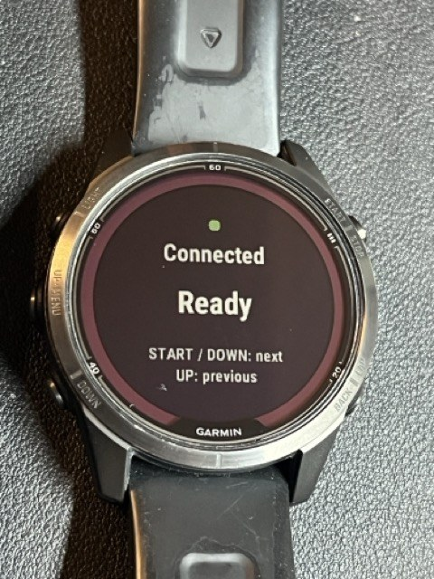
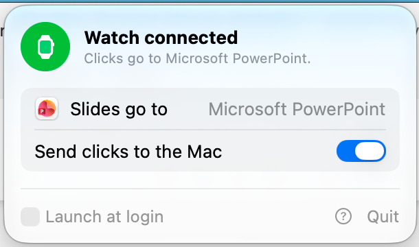
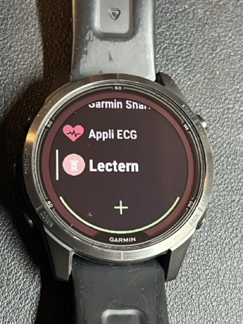
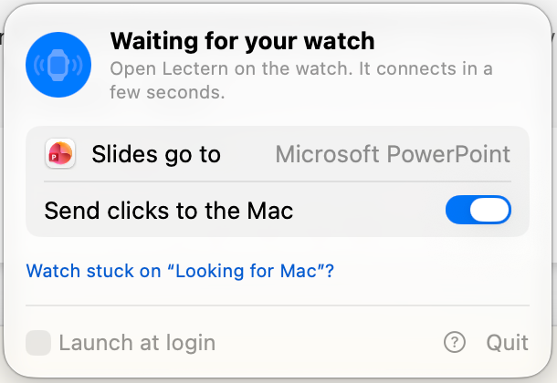
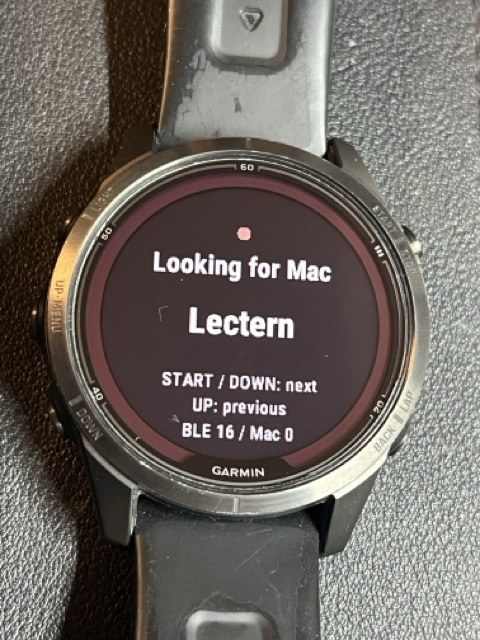

# Lectern

**Change slides from your Garmin watch.**

Lectern turns a Garmin fēnix 7 into a presentation clicker for Keynote, PowerPoint, Google Slides and anything else that moves on the arrow keys. Press a button on your wrist, the slide moves, and the watch ticks so you know it went through. There's no remote to forget and no Bluetooth pairing to set up.

  
  &nbsp;&nbsp;
  

## Why you'll like it

- **Buttons you can find without looking.** START or DOWN for the next slide, UP for the previous one.
- **You feel every click.** A short tick when the slide moved, a long buzz if it didn't.
- **Works with any presentation app.** Keynote, PowerPoint, Google Slides in a browser, PDF viewers: if the arrow keys move it, Lectern moves it.
- **Connects by itself.** Open Lectern on the watch and it finds your Mac in a few seconds. Your watch stays connected to your phone the whole time.
- **Shows where your clicks go.** The Mac menu names the app that will receive them, so you notice before your talk if the wrong window is in front.
- **Hard to trigger by accident.** The touchscreen is ignored, and BACK asks before quitting.
- **Private.** The watch talks straight to your Mac over Bluetooth. No account, no internet connection, nothing collected.

## What you need

- A Mac with **macOS 15 Sequoia** or later
- A **Garmin fēnix 7**, 7S, 7X, 7 Pro, 7S Pro or 7X Pro

## Install

Download both parts from the [latest release](https://github.com/benrichard-labs/lectern/releases/latest).

### On your Mac

1. Open `Lectern-<version>.dmg` and drag **Lectern** into **Applications**.
2. Open Lectern. It lives in the menu bar (▶︎ in a rectangle), not in the Dock.
3. When macOS asks for **Bluetooth** access, click **Allow**.
4. Click the menu bar icon and follow **Finish setup**: click **Allow…** next to *Send key presses*, then switch **Lectern** on in the list macOS opens. This is what lets Lectern press the arrow keys for you.
5. Optional: tick **Launch at login** at the bottom of the menu.

### On your watch

Lectern isn't on the Connect IQ Store yet, so you copy it onto the watch once.

1. Download the file for your model from the release: `Lectern-fenix7.prg`, `Lectern-fenix7s.prg`, `Lectern-fenix7x.prg`, `Lectern-fenix7pro.prg`, `Lectern-fenix7spro.prg` or `Lectern-fenix7xpro.prg`. Not sure which one you have? On the watch, go to **Settings › System › About**.
2. Install [OpenMTP](https://openmtp.ganeshrvel.com). The Mac's Finder can't open Garmin watches.
3. Connect the watch with its USB cable, open OpenMTP, and copy the `.prg` file into the watch's `GARMIN/APPS` folder.
4. Unplug the watch. **Lectern** now appears in its list of apps.

  

## Present with it

1. Open your presentation on the Mac and click into it, so it's the app in front.
2. On the watch, open **Lectern**. It shows *Looking for Mac*, then *Connected* with a double buzz.
3. Press **START** or **DOWN** for the next slide, **UP** for the previous one.
4. When you're done, press **BACK** and confirm.

Before you start, glance at the Lectern menu on the Mac: **Slides go to** should name your presentation app.

## The menu bar

The menu always leads with what's happening and what to do next.

  

The icon shows the same thing at a glance:

| Icon | Meaning |
| --- | --- |
| ▶︎ outline with a dot | Setup isn't finished. Open the menu to see what's missing. |
| ▶︎ outline | Ready, waiting for your watch |
| ▶︎ filled | Watch connected |
| ⏸ outline | Paused |

Turn off **Send clicks to the Mac** to rehearse with the watch without moving your slides. Each click still shows up in the menu, marked *not sent*.

## If something doesn't work

**The watch stays on "Looking for Mac"**

First check that the Mac menu says *Waiting for your watch*. If it says *Finish setup*, follow the steps it shows.

Then look at the small line at the bottom of the watch screen:

  

| Watch shows | What it means | What to do |
| --- | --- | --- |
| **BLE 0** | The watch hears no Bluetooth at all | Restart the watch |
| **BLE** above 0, **Mac 0** | The watch can't see your Mac | Make sure Lectern is running on the Mac. Turn the Mac's Bluetooth off and on, then reopen Lectern on the watch. |
| **Mac** keeps going up | The watch finds your Mac but can't connect | The orange line on the watch says why. Quit Lectern on the watch and open it again. |

The **?** button in the Mac menu shows the same tips.

**The watch is connected but slides don't move**

- In the Mac menu, check that **Slides go to** shows your presentation app. If not, click into your presentation.
- Check that **Send clicks to the Mac** is on.
- If the menu says *Finish setup*, *Send key presses* isn't allowed yet.

**After updating Lectern, *Send key presses* isn't allowed, even though Lectern is switched on in System Settings**

macOS sometimes keeps the permission for the old version. Quit Lectern, remove it from the list in System Settings with the **−** button, then open Lectern and click **Allow…** again.

**OpenMTP doesn't see the watch**

Unplug the watch, quit OpenMTP, and quit Garmin Express or Android File Transfer if you have them. In Terminal, run `killall ptpcamerad`, then plug the watch back in and open OpenMTP.

## Questions

**Why does it need an app on the Mac?**
Garmin watches can't act as a Bluetooth keyboard. The Mac app receives the button presses from the watch and turns them into arrow keys.

**Does it work with Windows, an iPad or other Garmin watches?**
Not today. It's Mac only, and the watch app is built for the fēnix 7 family. Other Garmin watches that run Connect IQ apps could be added later.

**Does it collect anything?**
No. Lectern doesn't connect to the internet, and the watch only ever sends "next" or "previous" to your Mac.

## For developers

How Lectern works, how to build it and how releases are made: [docs/DEVELOPMENT.md](docs/DEVELOPMENT.md).

## License

MIT. See [LICENSE](LICENSE).
